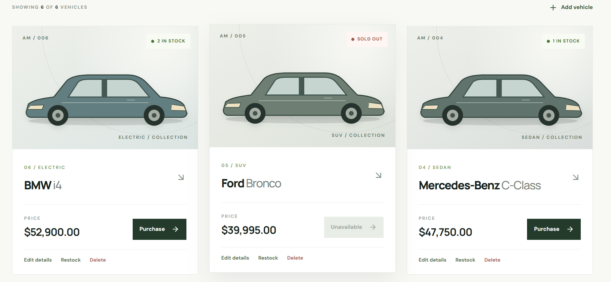
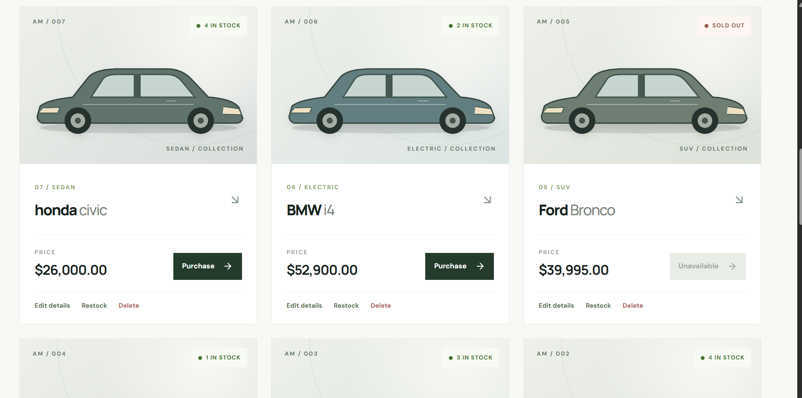
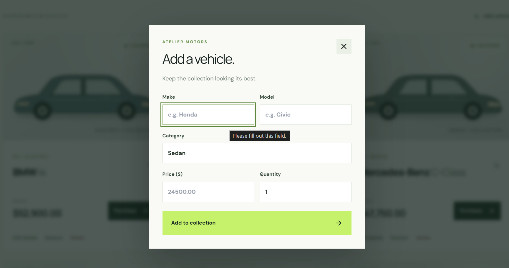
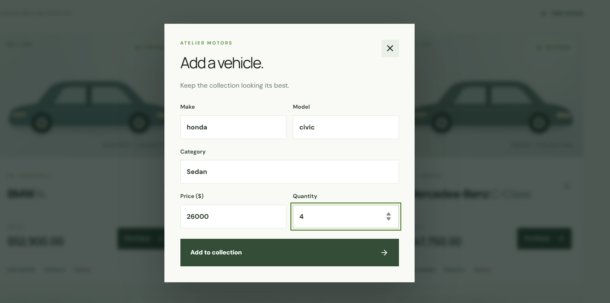

# Atelier Motors

**Public repository:** https://github.com/chaitanya-kad/atelier-motors-chaitanya

A full-stack car dealership inventory kata. The React showroom lets members browse, filter, and purchase vehicles; administrators manage the catalog and restock inventory. FastAPI serves a token-protected REST API backed by a persistent SQLite file.

## What makes it work

- **Inventory safety:** purchasing uses a conditional SQLite update inside `BEGIN IMMEDIATE`. When two requests race for the last unit, one succeeds and the other receives `409 Conflict`. Restock also enforces the one-million-unit cap inside the same transaction.
- **Money is stored exactly:** prices are validated to two decimal places and stored as integer cents. The API currently serializes prices as JSON numbers, so consumers should avoid binary-float arithmetic for money.
- **Role separation:** all vehicle routes require a JWT. Admin accounts alone can add, edit, delete, and restock. Registration always creates a regular user; the CLI provisions admins.
- **Useful UX:** responsive showroom, filters, stock badges, disabled sold-out buttons, confirmation dialogs, feedback, and admin controls.
- **Portable demo:** SQLite needs no external service; `seed_demo.py` populates an empty database with six example cars.

## Stack

| Layer | Technology |
| --- | --- |
| API | Python 3.12+, FastAPI, Pydantic, Uvicorn |
| Data | SQLite file, standard-library `sqlite3` |
| Auth | PBKDF2-SHA256 salted password hashes, 12-hour HS256 JWTs |
| UI | React 19, Vite 6, HTML5, CSS3, Tailwind CSS 3, Lucide icons |
| Tests | Pytest, FastAPI TestClient, temporary SQLite files |

## Run locally

### 1. Backend

```bash
cd backend
python -m venv .venv
# macOS/Linux:
source .venv/bin/activate
# Windows PowerShell: .venv\Scripts\Activate.ps1
python -m pip install -r requirements.txt
```

Set a secret and a database path in the same terminal. Generate a random secret for any non-demo use.

```bash
# macOS/Linux
export JWT_SECRET="$(python -c 'import secrets; print(secrets.token_urlsafe(48))')"
export DATABASE_PATH="./inventory.db"
python seed_demo.py                  # optional; only fills an empty catalog
python create_admin.py admin@example.com  # prompts for a password
python -m uvicorn app.main:app --reload --port 8000
```

```powershell
# Windows PowerShell
$env:JWT_SECRET = python -c "import secrets; print(secrets.token_urlsafe(48))"
$env:DATABASE_PATH = "./inventory.db"
python seed_demo.py
python create_admin.py admin@example.com
python -m uvicorn app.main:app --reload --port 8000
```

The API docs are at `http://localhost:8000/docs`. `create_admin.py` can create an admin or promote an existing account; use your own email and password. Never commit the SQLite database or secret.

### 2. Frontend

In a second terminal:

```bash
cd frontend
npm ci
npm run dev -- --host 127.0.0.1
```

Open `http://localhost:5173`. The Vite development server forwards `/api` requests to port 8000. Register as a member to browse and purchase, or log in as the admin created above to manage vehicles. For a production host, route `/api` to the backend or change the frontend API base and configure the backend CORS origins.

## API contract

Supply `Authorization: Bearer <token>` for every vehicle endpoint. JSON request bodies are shown for the mutations.

| Method | Path | Access | Behavior |
| --- | --- | --- | --- |
| POST | `/api/auth/register` | Public | Create member; returns token and user |
| POST | `/api/auth/login` | Public | Verify credentials; returns token and user |
| GET | `/api/vehicles` | Member | All vehicles, newest first |
| GET | `/api/vehicles/search` | Member | Optional `q` (across make/model/category), `make`, `model`, `category`, `min_price`, `max_price` |
| POST | `/api/vehicles` | Admin | Create vehicle |
| PUT | `/api/vehicles/{id}` | Admin | Replace vehicle details |
| DELETE | `/api/vehicles/{id}` | Admin | Delete vehicle; `204` |
| POST | `/api/vehicles/{id}/purchase` | Member | Decrease quantity by one; `409` if sold out |
| POST | `/api/vehicles/{id}/restock` | Admin | Increase quantity with `{ "amount": 2 }`; `409` if the stock cap would be exceeded |

Vehicle body: `{ "make": "Honda", "model": "Civic", "category": "Sedan", "price": 24500.50, "quantity": 2 }`. Invalid input returns `422`, missing vehicles `404`, invalid credentials `401`, and insufficient role `403`. Search text is case insensitive and partial; price limits are inclusive and accept two decimal places. Vehicle IDs are assigned by the database. Add and update are admin-only by design, matching the admin management UI.

## Tests and TDD

```bash
cd backend
python -m pytest --cov=app --cov-report=term-missing -q
cd ../frontend
npm test
npm run build
```

**History, honestly:** the first “red” commit failed at test collection because the app module did not exist; it is not an assertion-level red cycle. The initial implementation was also too large for ideal TDD. Later commits contain genuine failing assertions for boundary/JWT/email validation, combined search, restock limits, and pending-search UI, followed by passing fixes. One frontend refactor commit also bundled new behavior and tests without a prior red phase. The stock stress test uses 20 synchronized calls for 5 units. Tests use real temporary SQLite files. See [TEST_REPORT.md](TEST_REPORT.md) for captured results.

## Screenshots

I ran the UI locally and captured the showroom and admin screens.









## My AI Usage

**Tools:** ChatGPT (Codex) and Claude.

**How:** I used it to work through the assignment requirements, draft behavior tests before implementation, implement the FastAPI/SQLite and React/Tailwind code, debug a failing login test, and prepare documentation. I then used Claude as an independent judge-style reviewer. Its findings drove new failing tests and fixes for input limits, token validation, API search, stale stock, restock consistency, and the pending-search state. The code was checked with backend and frontend tests and a production frontend build. 
**Reflection:** AI sped up the first implementation but also produced a too-large initial commit and missed several edge cases. Claude's review exposed those gaps; I reproduced them in tests and fixed the code instead of treating the first output as final. Tests and a successful build verify specific behavior,while accessibility and deployment checks remain future work. I would explain the atomic SQL update, money representation, admin provisioning, and tradeoffs in an interview rather than treating generated code as self-explanatory.

The raw assignment prompt and AI conversation links are in [PROMPTS.md](PROMPTS.md). The Git commits use my author identity and include AI co-author trailers.

## Scope notes

This kata treats “purchase” as an inventory decrement; it does not collect payment or produce an order receipt. There is no hosted live deployment. SQLite is a good local database here; a hosted multi-instance deployment should use PostgreSQL and a managed secret. JWTs expire after 12 hours, and logging out removes the token from browser storage. In a larger app, add refresh/revocation, rate limiting, audit records, pagination, and migration tooling.
